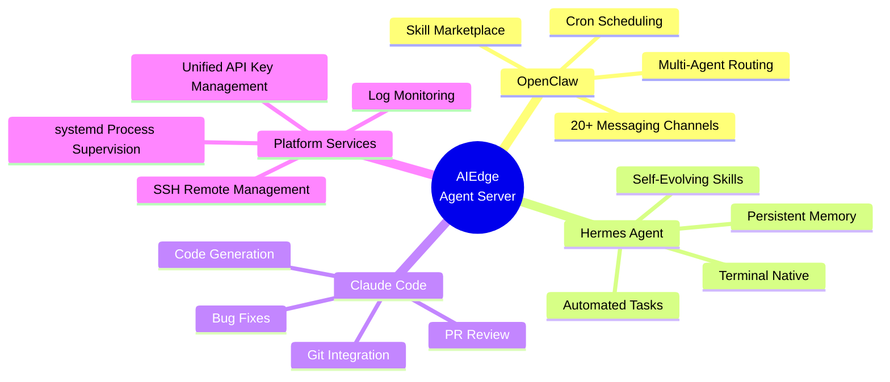

# ⚙️ Features

This chapter details the core features and use cases of the AIEdge Micro AI Agent Server.

---

## Chapter Navigation

- :material-robot: **[AI Agent Capabilities](inference.md)**
    
    Core capabilities of OpenClaw, Hermes Agent, and Claude Code — cloud model integration and API usage details.

- :material-server: **[Local Deployment Features](local-deploy.md)**
    
    24/7 online, unified API management, multi-channel access, local memory persistence, and more.

- :material-target: **[Use Cases](scenarios.md)**
    
    Typical application scenarios: enterprise office, software development, customer service, education & training.

- :material-message-text: **[Messaging Integration](wechat-integration.md)**
    
    Using WeChat as an example, detailed steps for connecting OpenClaw / Hermes Agent / Claude Code to messaging platforms.

---

## AIEdge Feature Landscape

---

## Quick Jump

- What agents are included? → [AI Agent Capabilities](inference.md)
- How is data security ensured? → [Local Deployment Features](local-deploy.md)
- What scenarios can it be used for? → [Use Cases](scenarios.md)
