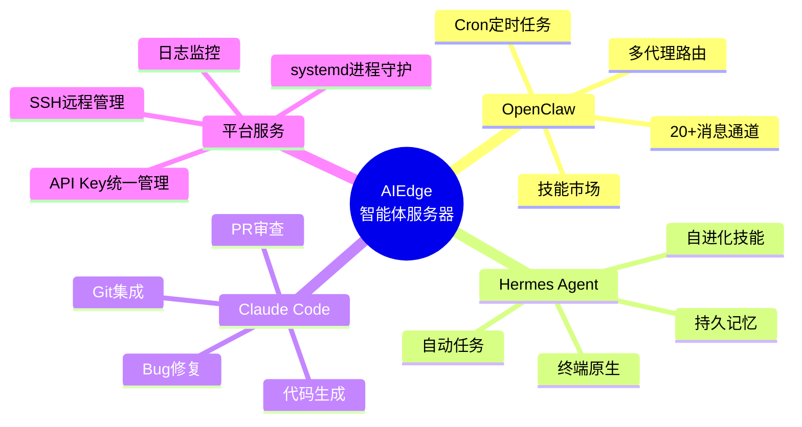

# ⚙️ 功能说明

本章节详细介绍 AIEdge 微型AI智能体服务器的核心功能与适用场景。

---

## 章节导航

- :material-robot: **[AI智能体能力](inference.md)**
    
    OpenClaw、Hermes Agent、Claude Code 三大智能体框架的核心能力、云端模型接入与 API 使用详解。

- :material-server: **[本地部署特性](local-deploy.md)**
    
    7×24 在线、统一API管理、多通道接入、本地记忆持久化等核心特性说明。

- :material-target: **[适用场景](scenarios.md)**
    
    企业办公、软件开发、客服运营、教育培训等典型应用场景介绍。

- :material-message-text: **[消息通道接入](wechat-integration.md)**
    
    以微信为例，详细讲解 OpenClaw / Hermes Agent / Claude Code 的消息通道接入方法。

---

## AIEdge 功能全景

---

## 快速跳转

- 有哪些智能体？→ [AI智能体能力](inference.md)
- 数据安全如何保障？→ [本地部署特性](local-deploy.md)
- 能用在哪些场景？→ [适用场景](scenarios.md)
