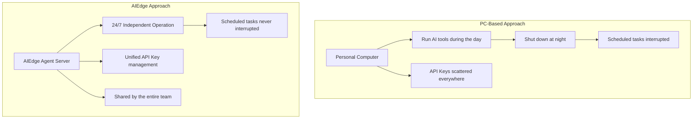
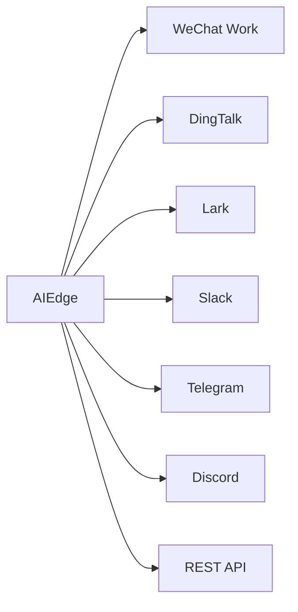

# Local Deployment Features

## Why a Local Agent Server?



---

## Core Features

### :material-clock-outline: 24/7 Always Online

AIEdge is an independent hardware device that doesn't depend on anyone's computer:

- :material-power: Only **5-10W** power draw — electricity cost is negligible
- :material-volume-off: Passive cooling, **completely silent**
- :material-server: Plug in and forget — stable long-term operation
- :material-restart: Supports scheduled restarts (e.g., weekly Sunday early AM auto-restart)

---

### :material-key-chain: Unified API Key Management

| Traditional Approach | AIEdge Approach |
|----------|------------|
| Each person configures Keys individually | **Device-level unified config, shared by the whole team** |
| High risk of Key leakage | **Access control + audit logging** |
| No usage control | **Usage monitoring + cost alerts** |
| Model switch requires informing everyone | **One switch, globally effective** |

```bash
# Admin configures the API Key once — team members never touch it
aiedge config set-api-key openrouter "sk-or-xxxxx"
# Automatically synced to OpenClaw / Hermes / Claude Code
```

---

### :material-message-text: Unified Multi-Channel Access

One device, all messaging platforms — team members interact with AI through their preferred tools:



---

### :material-shield-lock: Local Agent Data

!!! success "Data Privacy Guaranteed"
    - Agent **conversation memory, skill configs, and contact information** are all stored locally on the device
    - API calls only transmit the necessary conversation content to cloud LLMs
    - Sensitive enterprise data (customer lists, internal docs) can be stored locally as skill context
    - No need to upload data to third-party SaaS platforms

---

### :material-expand-all: Elastic Scaling

=== "Single-Node Mode"

    1GB / 2GB / 4GB models for independent deployment, from individual to small team use:
    
    - 1GB: Individual developer, 1-2 agents
    - 2GB: Small team, 3-5 agents
    - 4GB: Department-level, 5-10 agents

=== "Multi-Node Mode"

    Multiple AIEdge units forming an agent cluster:
    
    - Assign different devices to different departments
    - Heterogeneous config (dev team gets a Claude Code-dedicated unit, ops team gets an OpenClaw-dedicated unit)
    - Unified IP management

---

### :material-cog-sync: OTA Continuous Upgrades

- Regular Ubuntu security patch updates
- Auto-upgrade for OpenClaw / Hermes / Claude Code
- Continuously expanding pre-installed skill marketplace

---

## Comparison with Pure Cloud Solutions

| Dimension | AIEdge Local Agent Server | Pure Cloud SaaS Agent |
|:---------|:----------------------|:-------------------|
| Agent Uptime | :material-check: 24/7 persistent online | :material-alert: Depends on provider |
| Data Privacy | :material-check: Config/memory stored locally | :material-alert: Data on third-party servers |
| API Cost | :material-check: Direct to LLM providers | :material-alert: SaaS markup 20-50% |
| Customization | :material-check: Open-source frameworks, deep customization | :material-alert: Limited by platform |
| Ops Burden | :material-alert: Self-maintained | :material-check: Provider-maintained |
| Messaging Channels | :material-check: 20+ channels, free combination | :material-alert: Limited by platform support |

!!! summary "Conclusion"
    AIEdge is ideal for enterprise scenarios with **high requirements for data privacy, continuous uptime, and cost control**. Pure cloud SaaS is better suited for teams with zero tolerance for ops work and sufficient budget.
