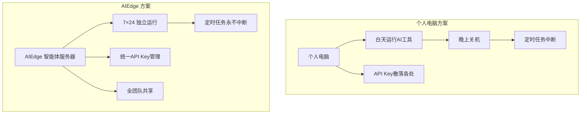
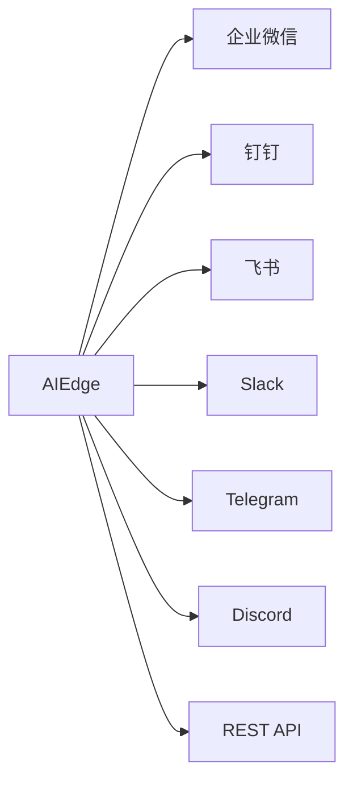

# 本地部署特性

## 为什么需要本地智能体服务器？



---

## 核心特性

### :material-clock-outline: 7×24 持续在线

AIEdge 是独立的硬件设备，不依赖任何人的电脑：

- :material-power: 功耗仅 **5-10W**，电费忽略不计
- :material-volume-off: 被动散热，**完全静音**
- :material-server: 插电即忘，长期稳定运行
- :material-restart: 支持定时重启（如每周日凌晨自动重启）

---

### :material-key-chain: 统一 API Key 管理

| 传统方式 | AIEdge 方案 |
|----------|------------|
| 每人电脑上各自配 Key | **设备统一配置，全团队共享** |
| Key 泄露风险高 | **权限管控 + 审计日志** |
| 无法控制用量 | **用量监控 + 成本告警** |
| 切换模型需逐一通知 | **一次切换，全局生效** |

```bash
# 管理员统一配置 API Key，团队成员无需接触
aiedge config set-api-key openrouter "sk-or-xxxxx"
# 自动同步到 OpenClaw / Hermes / Claude Code
```

---

### :material-message-text: 多通道统一接入

一个设备，接入所有消息平台，团队成员通过自己熟悉的工具与 AI 交互：



---

### :material-shield-lock: 智能体数据本地化

!!! success "数据隐私保障"
    - 智能体**对话记忆、技能配置、联系人信息**全部存储在设备本地
    - API 调用仅传输必要的对话内容到云端 LLM
    - 企业敏感数据（如客户名单、内部文档）可作为技能上下文存储在本地
    - 无需将数据上传至第三方 SaaS 平台

---

### :material-expand-all: 弹性扩展

=== "单机模式"

    1GB / 2GB / 4GB 版本独立部署，满足个人至小团队使用：
    
    - 1GB：个人开发者，1-2 个智能体
    - 2GB：小团队，3-5 个智能体
    - 4GB：部门级，5-10 个智能体

=== "多机模式"

    多台 AIEdge 组成智能体集群：
    
    - 按部门分配不同设备
    - 异构配置（开发团队用 Claude Code 专用机，运营团队用 OpenClaw 专用机）
    - 统一 IP 管理

---

### :material-cog-sync: OTA 持续升级

- Ubuntu 安全补丁定期更新
- OpenClaw / Hermes / Claude Code 自动升级
- 预装技能市场持续扩充

---

## 与纯云端方案对比

| 对比维度 | AIEdge 本地智能体服务器 | 纯云端 SaaS 智能体 |
|:---------|:----------------------|:-------------------|
| 智能体在线 | :material-check: 7×24 持久在线 | :material-alert: 依赖服务商 |
| 数据隐私 | :material-check: 配置/记忆本地存储 | :material-alert: 数据在第三方 |
| API 成本 | :material-check: 直接对接 LLM 供应商 | :material-alert: SaaS 加价 20-50% |
| 定制灵活 | :material-check: 开源框架，深度定制 | :material-alert: 受限于平台 |
| 运维难度 | :material-alert: 需自行维护 | :material-check: 服务商维护 |
| 消息通道 | :material-check: 20+ 通道自由组合 | :material-alert: 受限于平台支持 |

!!! summary "结论"
    AIEdge 适合**对数据隐私、持续在线、成本可控**有较高要求的企业场景。纯云端 SaaS 适合对运维零容忍、预算充足的团队。
