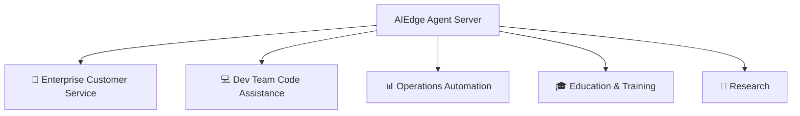

# Use Cases

## Scenario Overview

The AIEdge Micro AI Agent Server is suitable for a wide range of enterprise AI agent deployment scenarios:



---

## 🏢 Enterprise Customer Service

### 24/7 Multi-Channel Intelligent Customer Service

- WeChat Work / DingTalk / Lark / website — all channels covered
- Automatic product FAQ responses
- Peak-hour load distribution for human agents
- Self-service lookup for internal policies and procedures

```
Employee (WeChat Work): "How many annual leave days do I have?"
AIEdge Agent:           "According to Company Attendance Policy §3.2, you're entitled to
                         5 paid annual leave days after 1 year of service. You've used
                         2 days and have 3 remaining. Would you like me to submit a
                         leave request?"
```

---

## 💻 Dev Team Code Assistance

### Team-Shared AI Coding Assistant

- Claude Code runs 24/7 on AIEdge
- The whole team shares it via SSH — no individual installation needed
- Automatic GitHub PR review
- Scheduled codebase scans to detect potential issues

```bash
# Team members SSH in anytime
ssh root@[device IP]
cd /home/aiedge/projects/backend-api
claude "Review the latest PR #342 and suggest fixes"
```

### CI/CD Integration

- Git Webhook triggers Claude Code auto-review
- Automatic security checks on code commits
- Auto-generated Release Notes

---

## 📊 Operations Automation

### Daily Operations Tasks

- :material-email: **Email Summaries** — Summarize important unread emails to Slack every morning at 9:00
- :material-calendar: **Meeting Minutes** — Auto-generate meeting action items
- :material-trending-up: **Daily Reports** — Pull data from databases/APIs and generate daily reports
- :material-bell-ring: **Anomaly Alerts** — Monitor business metrics and proactively push alerts on anomalies

```bash
# Hermes Agent cron job examples
hermes cron add "0 9 * * 1-5" "morning-briefing-email-summary"
hermes cron add "0 18 * * 1-5" "daily-sales-report-to-slack"
hermes cron add "*/30 * * * *" "monitor-server-health-check"
```

---

## 🎓 Education & Training

### AI Agent Teaching Platform

- Students can experience AI agents without registering for cloud services
- Hands-on agent configuration and skill development practice
- Course-specific AI Q&A agents
- Code review assistance for programming courses

---

## 🔬 Research

### Agent Research & Experimentation Platform

- Compare response quality across different LLM providers
- Study agent behavior patterns
- Rapid iteration testing for skill development
- Multi-agent collaboration experiments

!!! tip "Academic Collaboration"
    Universities and research institutions may apply for academic partnership discounts — contact our business email for details.

---

## Scenario Selection Guide

| Your Need | Recommended Solution |
|:---------|:---------|
| Personal dev/learning | AIEdge (4GB / 128GB) |
| Small team CS/automation | AIEdge (4GB / 128GB) |
| Department-level multi-agent | AIEdge (4GB / 128GB), multiple units optional |
| Classified environment, fully offline | Not applicable (requires API internet access) |
| Large team, multi-scenario | Multiple AIEdge units, zoned deployment |
