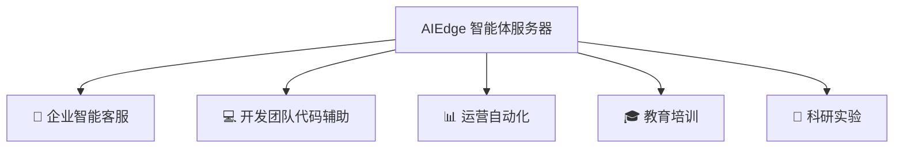

# 适用场景

## 场景总览

AIEdge 微型AI智能体服务器适用于多种企业级 AI 智能体部署场景：



---

## 🏢 企业智能客服

### 24小时多渠道智能客服

- 企业微信 / 钉钉 / 飞书 / 官网全渠道接入
- 产品FAQ自动回答
- 人工客服高峰期分流
- 内部制度/流程自助查询

```
员工（企业微信）：「今年年假怎么算？」
AIEdge 智能体：    「根据公司考勤制度第3.2条，您入职满1年享有5天带薪年假。
                    目前已使用2天，剩余3天。需要帮您提交请假申请吗？」
```

---

## 💻 开发团队代码辅助

### 团队共享的 AI 编程助手

- Claude Code 7×24 运行在 AIEdge 上
- 全团队通过 SSH 共用，无需每人安装配置
- 自动 Review GitHub PR
- 定时扫描代码库发现潜在问题

```bash
# 团队成员随时 SSH 登录使用
ssh root@[设备IP]
cd /home/aiedge/projects/backend-api
claude "Review the latest PR #342 and suggest fixes"
```

### CI/CD 集成

- Git Webhook 触发 Claude Code 自动审查
- 代码提交后自动运行安全检查
- 自动生成 Release Notes

---

## 📊 运营自动化

### 日常运营任务

- :material-email: **邮件摘要** — 每天早上 9:00 总结未读重要邮件发送到 Slack
- :material-calendar: **会议纪要** — 自动生成会议待办事项
- :material-trending-up: **数据日报** — 从数据库/API 拉取数据，生成日报
- :material-bell-ring: **异常告警** — 监控业务指标，异常时主动推送通知

```bash
# Hermes Agent 定时任务示例
hermes cron add "0 9 * * 1-5" "morning-briefing-email-summary"
hermes cron add "0 18 * * 1-5" "daily-sales-report-to-slack"
hermes cron add "*/30 * * * *" "monitor-server-health-check"
```

---

## 🎓 教育培训

### AI 智能体教学平台

- 学生无需注册云服务即可体验 AI 智能体
- 动手实践智能体配置与技能开发
- 课程配套的 AI 答疑智能体
- 编程教学中的代码审查辅助

---

## 🔬 科研实验

### 智能体研究实验平台

- 对比不同 LLM 供应商的响应质量
- 智能体行为模式研究
- 技能开发的快速迭代测试
- 多代理协作实验

!!! tip "学术合作"
    高校与科研机构可申请学术合作优惠，详询商务邮箱。

---

## 场景选型建议

| 您的需求 | 推荐方案 |
|:---------|:---------|
| 个人开发/学习 | AIEdge（4GB / 128GB） |
| 小团队客服/自动化 | AIEdge（4GB / 128GB） |
| 部门级多智能体 | AIEdge（4GB / 128GB），可多台部署 |
| 涉密环境，完全离线 | 不适用（需 API 联网） |
| 大型团队多场景 | 多台 AIEdge 分区部署 |
