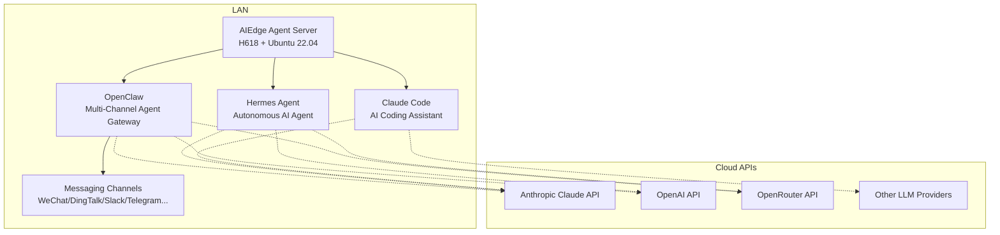

<!-- Hero Section -->
<div class="home-hero" markdown="1">

{: .hero-logo }

# AIEdge Micro AI Agent Server

**24/7 Online · Multi-Channel AI Agents · Cloud LLM Powered**

Powered by H618 + Ubuntu 22.04, pre-installed with Mihomo (Clash) / OpenClaw / Hermes / Claude Code — a turnkey enterprise-grade AI agent server.

</div>

---

## Documentation Navigation

<div class="home-cards" markdown="1">

<div class="home-card" markdown="1">
<div class="card-icon">🏢</div>
<h3>Company</h3>
<p>Learn about HydroSpring Technology, our core business, technical advantages, and service philosophy.</p>
<a class="card-link" href="company/">Learn More →</a>
</div>

<div class="home-card" markdown="1">
<div class="card-icon">🚀</div>
<h3>Quick Start</h3>
<p>From unboxing to your first AI conversation — deploy and launch your AIEdge agent server in 15 minutes.</p>
<a class="card-link" href="quickstart/">Learn More →</a>
</div>

<div class="home-card" markdown="1">
<div class="card-icon">📖</div>
<h3>User Manual</h3>
<p>Complete guide covering installation, configuration, and maintenance for daily operations.</p>
<a class="card-link" href="manual/">Learn More →</a>
</div>

<div class="home-card" markdown="1">
<div class="card-icon">⚙️</div>
<h3>Features</h3>
<p>Deep dive into AIEdge's agent capabilities, API gateway features, and use cases.</p>
<a class="card-link" href="features/">Learn More →</a>
</div>

<div class="home-card" markdown="1">
<div class="card-icon">❓</div>
<h3>FAQ</h3>
<p>Quick troubleshooting for boot issues, networking, API configuration, agent usage, and more.</p>
<a class="card-link" href="faq/">Learn More →</a>
</div>

<div class="home-card" markdown="1">
<div class="card-icon">📚</div>
<h3>Resources</h3>
<p>Tech spec downloads, tool references, support contacts, and additional resources.</p>
<a class="card-link" href="resources/">Learn More →</a>
</div>

</div>

---

## About the AIEdge Micro AI Agent Server

**AIEdge** is HydroSpring Technology's self-developed desktop-class micro AI agent server, built on the Allwinner H618 chip + Ubuntu 22.04, with Mihomo (Clash), OpenClaw, Hermes Agent, and Claude Code pre-installed. The device itself does not run large language models locally — instead, it operates as a **24/7 agent runtime + API gateway**, delivering AI agent services to your organization by calling cloud LLMs (Anthropic Claude, OpenAI GPT, OpenRouter, etc.).

### Core Features

| Feature | Description |
|------|------|
| :material-robot: **Multi-Agent Framework** | Pre-installed Mihomo + OpenClaw + Hermes + Claude Code, ready out of the box |
| :material-cloud-sync: **Cloud Model Powered** | Leverages the world's best cloud LLMs via API — no local GPU required |
| :material-clock-fast: **24/7 Always Online** | Low power (5-10W), built for uninterrupted long-term operation |
| :material-message-text: **Multi-Platform Access** | Supports 20+ messaging channels: WeChat, DingTalk, Lark, Slack, Telegram, and more |
| :material-shield-lock: **Enterprise-Grade Privacy** | Agent configs, memory, and skill data stored 100% locally |
| :material-wifi: **LAN Deployment** | Works on your local network; only needs outbound API access |

---

## Architecture



---

## Quick Start

```bash
# Step 1: Unbox, connect power and network
# Step 2: SSH into the device (check IP in your router admin or via HDMI display)
ssh root@192.168.1.xxx  # Default password: hybio.tech (no echo while typing)

# Step 3: Configure your LLM API Key
openclaw config set ANTHROPIC_API_KEY "sk-ant-..."
openclaw config set OPENAI_API_KEY "sk-..."

# Step 4: Start agent services
openclaw onboard --install-daemon
hermes setup

# Step 5: Connect agents to your messaging platforms (WeChat/DingTalk/Slack/etc.)
# See the Quick Start chapter for detailed instructions
```

[:material-arrow-right-bold: View Full Quick Start Guide](quickstart/){ .md-button .md-button--primary }

---

## Tech Stack

<div class="grid cards" markdown="1">

- :material-chip: **H618 Chip** — Allwinner H618, quad-core Cortex-A53, low-power long-life operation
- :material-linux: **Ubuntu 22.04 LTS** — Standard Linux server environment, developer-friendly
- :material-robot-outline: **OpenClaw** — Open-source multi-channel AI agent framework, 20+ platform support
- :material-console: **Hermes Agent** — Native terminal autonomous agent with persistent memory & self-evolution
- :material-code-braces: **Claude Code** — Anthropic's official AI coding CLI tool
- :material-cloud: **API-Driven** — Calls top-tier cloud models, no local compute consumed
- :material-shield: **Mihomo (Clash)** — Transparent proxy ensuring uninterrupted API connectivity

</div>
