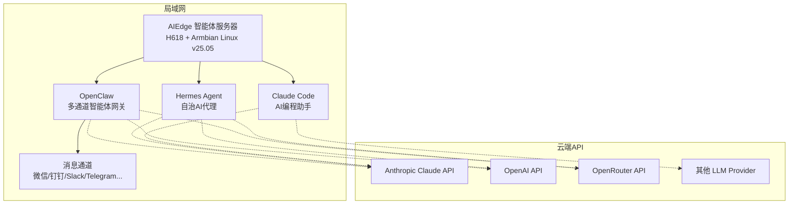

<!-- Hero 区域 -->
<div class="home-hero" markdown="1">

{: .hero-logo }

# AIEdge 微型AI智能体服务器

**7×24 小时在线 · 多通道AI智能体 · 云端大模型驱动**

基于 H618 + Armbian Linux v25.05，预装 Mihomo (Clash) / OpenClaw / Hermes / Claude Code，开箱即用的企业级 AI 智能体服务器。

</div>

---

## 文档导航

<div class="home-cards" markdown="1">

<div class="home-card" markdown="1">
<div class="card-icon">🏢</div>
<h3>公司介绍</h3>
<p>了解氢春科技的企业概况、核心业务、技术优势与服务理念。</p>
<a class="card-link" href="company/">了解更多 →</a>
</div>

<div class="home-card" markdown="1">
<div class="card-icon">🚀</div>
<h3>快速入门</h3>
<p>从开箱到首次对话，15 分钟完成 AIEdge 智能体服务器的部署与启动。</p>
<a class="card-link" href="quickstart/">了解更多 →</a>
</div>

<div class="home-card" markdown="1">
<div class="card-icon">📖</div>
<h3>使用手册</h3>
<p>完整的设备安装、配置、运维指南，覆盖日常使用全流程。</p>
<a class="card-link" href="manual/">了解更多 →</a>
</div>

<div class="home-card" markdown="1">
<div class="card-icon">⚙️</div>
<h3>功能说明</h3>
<p>深入了解 AIEdge 的智能体能力、API网关特性与适用场景。</p>
<a class="card-link" href="features/">了解更多 →</a>
</div>

<div class="home-card" markdown="1">
<div class="card-icon">❓</div>
<h3>常见问题</h3>
<p>设备启动、联网、API配置、智能体使用等常见问题的快速排查。</p>
<a class="card-link" href="faq/">了解更多 →</a>
</div>

<div class="home-card" markdown="1">
<div class="card-icon">📚</div>
<h3>更多资料</h3>
<p>技术参数表、工具下载、技术支持联系方式等辅助资源。</p>
<a class="card-link" href="resources/">了解更多 →</a>
</div>

</div>

---

## 关于 AIEdge 微型AI智能体服务器

**AIEdge** 是氢春科技自主研发的桌面级微型AI智能体服务器，基于全志 H618 芯片 + Armbian Linux v25.05，出厂预装 Mihomo (Clash)、OpenClaw、Hermes Agent、Claude Code 四大核心框架。设备本身不运行大模型，而是作为 **7×24 小时在线的智能体运行时 + API 网关**，通过调用云端 LLM（Anthropic Claude、OpenAI GPT、OpenRouter 等）为企业提供 AI 智能体服务。

### 核心特性

| 特性 | 说明 |
|------|------|
| :material-robot: **多智能体框架** | 预装 Mihomo + OpenClaw + Hermes + Claude Code，开箱即用 |
| :material-cloud-sync: **云端模型驱动** | 通过 API 调用业界最强云端大模型，无需本地算力 |
| :material-clock-fast: **7×24 持续在线** | 低功耗（5-10W），适合长期运行，永不"下班" |
| :material-message-text: **多平台接入** | 支持微信/钉钉/飞书/Slack/Telegram 等 20+ 消息通道 |
| :material-shield-lock: **企业级隐私** | 智能体配置、记忆、技能数据 100% 本地存储 |
| :material-wifi: **局域网部署** | 内网即可使用，对外仅需 API 出口 |

---

## 运行架构



---

## 快速开始

```bash
# 第一步：开箱检查，接通电源和网络
# 第二步：SSH 登录设备（在路由器后台或HDMI显示器查看IP）
ssh root@192.168.1.xxx  # 默认密码：hybio.tech（输入时不显示，盲输回车）

# 第三步：配置您的 LLM API Key
openclaw config set ANTHROPIC_API_KEY "sk-ant-..."
openclaw config set OPENAI_API_KEY "sk-..."

# 第四步：启动智能体服务
openclaw onboard --install-daemon
hermes setup

# 第五步：将智能体接入您的消息平台（微信/钉钉/Slack等）
# 详细步骤请参阅 快速入门 章节
```

[:material-arrow-right-bold: 查看完整快速入门指南](quickstart/){ .md-button .md-button--primary }

---

## 技术栈

<div class="grid cards" markdown="1">

- :material-chip: **H618 芯片** — 全志 H618，四核 Cortex-A53，4GB 内存 / 128GB eMMC
- :material-linux: **Armbian Linux v25.05** — 内核 6.12.11-edge-sunxi64，标准 Linux 服务器环境
- :material-usb: **USB / TF 扩展** — 支持外接 U 盘、移动硬盘与 MicroSD 卡扩展存储
- :material-robot-outline: **OpenClaw** — 开源多通道AI智能体框架，20+平台接入
- :material-console: **Hermes Agent** — 终端原生自治代理，持久记忆与自进化
- :material-code-braces: **Claude Code** — Anthropic 官方AI编程CLI工具
- :material-cloud: **API驱动** — 调用云端顶级模型，不消耗本地算力
- :material-shield: **Mihomo (Clash)** — 透明代理，保障 API 链路畅通无阻

</div>
