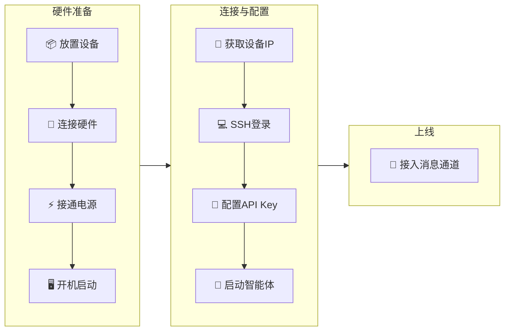

# 首次部署流程

## 部署概览

首次部署 AIEdge 微型AI智能体服务器的完整流程：



---

## 第一步：放置设备

选择设备安装位置：

!!! tip "安装位置建议"
    - :material-check: 通风良好、远离热源
    - :material-check: 平稳桌面，避免振动
    - :material-check: 靠近网口和电源插座
    - :material-check: 周边保留 5cm 以上散热空间
    - :material-close: 避免阳光直射
    - :material-close: 避免潮湿、多尘环境

---

## 第二步：连接硬件

1. 将网线一端插入设备的 **RJ45** 口，另一端插入路由器 LAN 口
2. 将电源适配器连接设备供电口，插入插座
3. 前面板蓝色指示灯闪烁后常亮，系统启动完成
4. 后续操作可选：
    - **SSH 配置**：在路由器后台找到设备 IP，通过电脑 SSH 登录
    - **HDMI 直连**：连接 HDMI 显示器和键盘，直接在终端操作

---

## 第三步：获取设备 IP 地址

设备需要获取 IP 地址后，才能通过 SSH 登录。有两种方式获取 IP：

=== "方式一：路由器后台查看（推荐）"

    1. 打开路由器管理页面（通常是 `http://192.168.1.1`）
    2. 找到「DHCP 客户端列表」或「已连接设备」
    3. 查找主机名为 `aiedge` 的设备
    4. 记录其 IP 地址（如 `192.168.1.105`）

=== "方式二：HDMI 显示器查看"

    1. 将设备通过 HDMI 连接显示器
    2. 设备启动完成后，显示器上会出现登录提示
    3. 使用默认账户登录：
    
    ```
    用户名：root
    密码：  hybio.tech
    ```
    
    !!! tip "输入密码提示"
        输入密码时屏幕**不会显示**任何字符（无 `***` 回显），盲输完成后直接按回车即可。
    
    4. 登录后执行以下命令查看 IP：
    
    ```bash
    ip a
    ```
    
    5. 找到 `eth0` 对应的 `inet` 地址，即为设备在局域网中的 IP 地址（如 `192.168.1.105`）

---

## 第四步：SSH 登录设备

拿到设备 IP 后，在电脑上打开 **PowerShell**（Windows）或**终端**（macOS / Linux），输入以下命令：

```bash
# 使用设备 IP 登录（将 192.168.1.105 替换为实际 IP）
ssh root@192.168.1.105
```

!!! info "默认账户"
    用户名：`root`｜密码：`hybio.tech`

    **注意**：输入密码时屏幕不会显示任何字符（这是 Linux 的安全设计），盲输后按回车确认即可。

!!! tip "首次登录提示"
    首次通过 SSH 登录时会提示修改密码，建议设置一个高强度密码。

---

## 第五步：启动网络代理（可选）

如果您在国内使用，调用 Anthropic / OpenAI 等海外 API 可能受限。AIEdge 可选用 **Mihomo (Clash)** 透明代理，配置好订阅即可保障 API 链路畅通。

!!! note "代理订阅"
    Clash 订阅需要自行准备，您可以购买付费订阅，或使用各服务商提供的免费订阅链接。设备本身不含代理订阅。

```bash
# 1. 编辑 Mihomo 配置文件，填入您的订阅链接或节点信息
sudo nano /etc/mihomo/config.yaml

# 2. 启动代理服务
sudo systemctl start mihomo

# 3. 查看运行状态
sudo systemctl status mihomo

# 4. 设置开机自动启动（推荐）
sudo systemctl enable mihomo

# 5. 验证代理连通性
curl -x http://127.0.0.1:7890 https://api.anthropic.com
```

!!! note "跳过条件"
    如果您已通过路由器层代理或无需代理即可访问海外 API，可跳过此步。

---

## 第六步：配置 LLM API Key

!!! important "重要"
    AIEdge 本身**不运行本地模型**，所有 AI 能力通过调用云端 LLM API 实现。您需要至少配置一个 LLM 供应商的 API Key。

=== "配置 Anthropic Claude"

    ```bash
    # 为智能体框架设置 Anthropic API Key
    openclaw config set ANTHROPIC_API_KEY "sk-ant-xxxxxxxxxxxxx"
    hermes config set ANTHROPIC_API_KEY "sk-ant-xxxxxxxxxxxxx"
    
    # Claude Code
    claude config set apiKey "sk-ant-xxxxxxxxxxxxx"
    ```

=== "配置 OpenAI"

    ```bash
    openclaw config set OPENAI_API_KEY "sk-xxxxxxxxxxxxx"
    hermes config set OPENAI_API_KEY "sk-xxxxxxxxxxxxx"
    ```

=== "配置 DeepSeek"

    ```bash
    # DeepSeek 兼容 OpenAI API 格式
    openclaw config set OPENAI_API_KEY "sk-xxxxxxxxxxxxx"
    openclaw config set OPENAI_BASE_URL "https://api.deepseek.com"
    
    hermes config set provider deepseek
    hermes config set DEEPSEEK_API_KEY "sk-xxxxxxxxxxxxx"
    ```

=== "配置 OpenRouter（多模型统一入口）"

    ```bash
    openclaw config set OPENROUTER_API_KEY "sk-or-xxxxxxxxxxxxx"
    hermes config set OPENROUTER_API_KEY "sk-or-xxxxxxxxxxxxx"
    ```

!!! tip "推荐"
    使用 **OpenRouter** 作为统一 API 入口，一个 Key 访问 Anthropic / OpenAI / Google / DeepSeek 等全部模型，支持自动故障切换与成本路由。

---

## 第七步：启动智能体服务

### 启动 OpenClaw

```bash
# 安装并启动 OpenClaw 守护进程
openclaw onboard --install-daemon

# 检查状态
openclaw status
```

### 启动 Hermes Agent

```bash
# 初始化并启动 Hermes
hermes setup
hermes start --daemon

# 检查状态
hermes status
```

### 使用 Claude Code

```bash
# 进入项目目录，直接使用
cd /root/projects
claude "帮我分析一下当前项目的代码结构"
```

---

## 第八步：接入消息通道

将智能体接入您的团队消息平台。详细步骤请参阅 **[消息通道接入指南](../features/wechat-integration.md)**，以下为快速索引：

| 平台 | OpenClaw | Hermes Agent | Claude Code |
|------|:--------:|:------------:|:-----------:|
| :material-wechat: 微信 | 官方插件 + 扫码 | 原生 iLink + 扫码 | 第三方桥接 |
| :material-chat: 钉钉 | OpenClaw 钉钉插件 | — | — |
| :material-bird: 飞书 | OpenClaw 飞书插件 | — | — |
| :material-slack: Slack | `@openclaw/slack` | — | — |
| :material-send: Telegram | `@openclaw/telegram` | — | — |

[:material-arrow-right-bold: 查看完整微信接入教程](../features/wechat-integration.md){ .md-button }

---

## 部署验证清单

完成以上步骤后，请逐项确认：

- [ ] 设备通电正常，蓝色指示灯常亮
- [ ] 能通过 SSH 登录设备（`ssh root@[设备IP]`）
- [ ] 已修改默认密码
- [ ] Mihomo 代理已配置（如需），网络连接正常（`curl -x http://127.0.0.1:7890 https://api.anthropic.com`）
- [ ] 至少一个 LLM API Key 已配置
- [ ] OpenClaw 守护进程运行中
- [ ] Hermes Agent 启动正常
- [ ] Claude Code 可正常调用

!!! success "恭喜！"
    全部完成后，您的 AIEdge 微型AI智能体服务器已经可以使用了！

---

## 下一步

完成首次部署后，继续阅读 **[局域网快速启动](lan-start.md)**，了解如何在局域网中日常使用设备。
