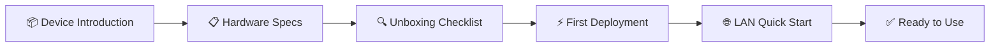

# 🚀 Quick Start

Welcome to the AIEdge Micro AI Agent Server! This chapter will guide you through the complete journey — from unboxing to your first AI agent conversation — in **under 15 minutes**.

---

## Getting Started Overview

---

## Chapter Navigation

- **[Device Introduction](overview.md)** — Learn about AIEdge's product positioning and the agent server concept
- **[Hardware Specifications](specs.md)** — H618 chip parameters, interface details, software stack
- **[Unboxing Checklist](unbox.md)** — Post-delivery checklist and accessory verification
- **[First Deployment](deploy.md)** — SSH login, API Key configuration, agent service startup
- **[LAN Quick Start](lan-start.md)** — Daily use: messaging channel integration, scheduled task setup

---

## Preparation Checklist

Before you begin, make sure you have the following ready:

- [x] AIEdge Micro AI Agent Server ×1
- [x] Type-C power cable (included with device; some models include adapter)
- [x] Ethernet cable ×1 (Cat5e or above)
- [x] A computer with internet access (for SSH management), or HDMI cable + monitor + keyboard (for direct operation)
- [x] At least one LLM API Key (Anthropic / OpenAI / OpenRouter, etc.)
- [x] LAN router (providing DHCP + internet access)

!!! tip "API Key"
    **The device itself does not run LLMs locally.** All AI capabilities are delivered through cloud APIs. Please register with at least one LLM provider and obtain an API Key in advance.

---

## Next Step

Start by reading **[Device Introduction](overview.md)** to understand AIEdge basics, then proceed through the remaining chapters in order.
