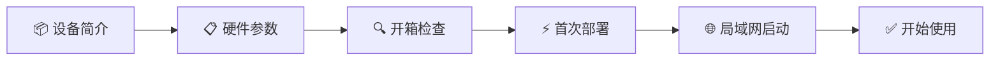

# 🚀 快速入门

欢迎使用 AIEdge 微型AI智能体服务器！本章节将引导您在 **15 分钟内**完成从开箱到首次 AI 智能体对话的完整流程。

---

## 入门流程概览

---

## 章节导航

- **[设备简介](overview.md)** — 了解 AIEdge 的产品定位与智能体服务器概念
- **[硬件参数](specs.md)** — H618 芯片参数、接口说明、预装软件栈
- **[开箱检查](unbox.md)** — 收货后的检查清单与配件核对
- **[首次部署流程](deploy.md)** — SSH登录、API Key配置、智能体服务启动
- **[局域网快速启动](lan-start.md)** — 日常使用：消息通道接入、定时任务设置

---

## 准备清单

开始之前，请确保您已准备以下环境：

- [x] AIEdge 微型AI智能体服务器 ×1
- [x] Type-C 电源线（随设备附带，部分型号提供）
- [x] 网线 ×1（Cat5e 及以上）
- [x] 一台可联网的电脑（用于 SSH 登录管理），或 HDMI 线 + 显示器 + 键盘（直连操作）
- [x] 一个 LLM API Key（Anthropic / OpenAI / OpenRouter 等，至少一个）
- [x] 局域网路由器（提供 DHCP 服务 + 互联网出口）

!!! tip "API Key"
    **设备本身不运行大模型**，所有 AI 能力通过云端 API 实现。请提前注册至少一个 LLM 供应商账号并获取 API Key。

---

## 下一步

请先阅读 **[设备简介](overview.md)**，了解 AIEdge 的基本信息，然后按顺序完成后续章节。
