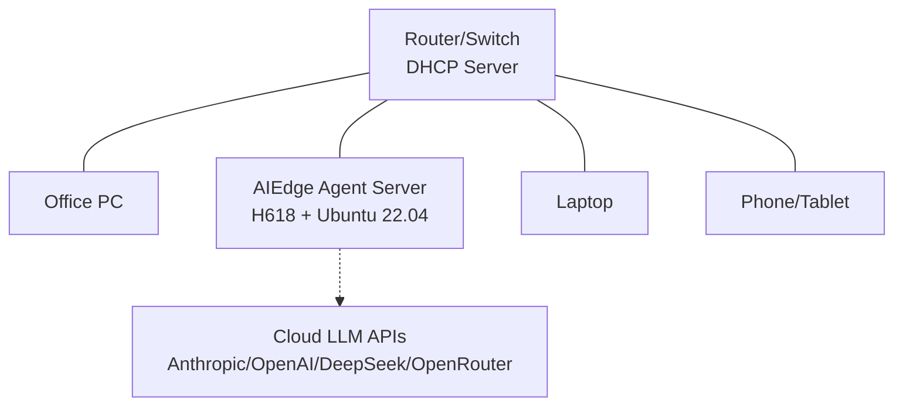

# LAN Quick Start

## Overview

The AIEdge Micro AI Agent Server is designed for **plug-and-play on your local network**. This chapter covers daily use in your LAN environment.

---

## Network Topology



The device needs internet access (for LLM API calls) and must be reachable from other devices on the LAN.

---

## Daily Usage Flow

### 1. Get the Device IP

| Method | Description |
|------|------|
| **Router Admin** | Find hostname `aiedge` in the DHCP client list |
| **HDMI Display** | Connect monitor, log in as root, run `ip a` to see eth0 address |
| **Scan Tool** | `nmap -p 22 192.168.1.0/24` to scan for SSH ports |

### 2. SSH Login

```bash
ssh root@[device IP]
# Password: hybio.tech (no echo while typing; press Enter after blind-typing)
```

---

## Usage Scenarios

### Scenario 1: Chat with Agents via Messaging Platforms

Once messaging channels are configured, team members can @-mention the agent directly in WeChat/DingTalk/Slack:

```
# In a DingTalk group
@AI Assistant  Summarize today's customer feedback

# In Slack
@OpenClaw What are the open PRs that need review?
```

### Scenario 2: Code Assistance with Claude Code

```bash
# SSH into the device
ssh root@[device IP]

# Use Claude Code in your project
cd /root/projects/my-service
claude "Review the current changes and suggest improvements"
```

### Scenario 3: Scheduled Automation Tasks

```bash
# Hermes Agent cron example
# Send a daily todo summary to Slack at 9:00 AM
hermes cron add "0 9 * * *" "summarize today's todos and send to slack"

# OpenClaw heartbeat monitoring
openclaw skill install github-pr-monitor
openclaw cron add "*/30 * * * *" github-pr-monitor
```

---

## API Call Examples

### OpenClaw API

```bash
curl http://[device IP]:18789/v1/chat \
  -H "Content-Type: application/json" \
  -d '{
    "agent": "default",
    "message": "Analyze recent sales data trends",
    "channel": "api"
  }'
```

### Hermes Agent API

```bash
curl http://[device IP]:11434/v1/agent/chat \
  -H "Content-Type: application/json" \
  -d '{
    "message": "Generate a weekly report template",
    "stream": false
  }'
```

---

## Multi-User Concurrency

AIEdge supports simultaneous use by multiple team members:

| Scenario | Recommended Config |
|------|----------|
| Personal use | 1GB model, 1-2 agents |
| Small team (2-5 people) | 2GB model, 3-5 agents |
| Department (5-15 people) | 4GB model, 5-10 agents |

!!! warning "Concurrency Notes"
    Agent response speed depends mainly on **cloud API response time**. For 2GB and lower models, we recommend no more than 3 concurrently active agents.

---

## Next Step

After LAN deployment, read the **[User Manual](../manual/index.md)** for more maintenance knowledge.
