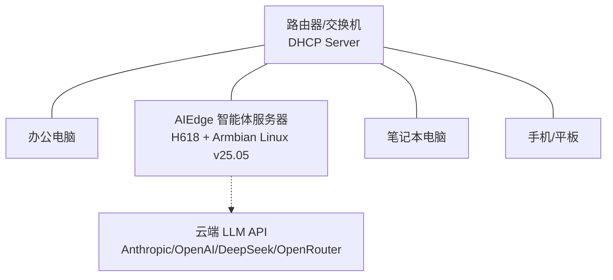

# 局域网快速启动

## 概述

AIEdge 微型AI智能体服务器设计为**局域网内即插即用**。本章节介绍如何在您的局域网环境中日常使用设备。

---

## 网络拓扑



设备需能访问互联网（用于调用 LLM API），可与局域网内设备互访。

---

## 日常使用流程

### 1. 获取设备 IP

| 方法 | 说明 |
|------|------|
| **路由器后台** | DHCP 客户端列表中查找主机名 `aiedge` |
| **HDMI 显示器** | 接显示器，登录 root，执行 `ip a` 查看 eth0 地址 |
| **扫描工具** | `nmap -p 22 192.168.1.0/24` 扫描 SSH 端口 |

### 2. SSH 登录

```bash
ssh root@[设备IP]
# 密码：hybio.tech（输入时屏幕不显示，盲输后回车）
```

---

## 使用场景

### 场景一：通过消息平台与智能体对话

配置好消息通道后，团队成员直接在微信/钉钉/Slack 中 @ 智能体即可对话：

```
# 钉钉群里使用
@AI助手 帮我总结一下今天的客户反馈

# Slack 里使用
@OpenClaw What are the open PRs that need review?
```

### 场景二：通过 Claude Code 进行代码辅助

```bash
# SSH 登录设备
ssh root@[设备IP]

# 在项目中使用 Claude Code
cd /root/projects/my-service
claude "Review the current changes and suggest improvements"
```

### 场景三：设置定时自动化任务

```bash
# Hermes Agent 定时任务示例
# 每天早上 9:00 发送今日待办摘要到 Slack
hermes cron add "0 9 * * *" "summarize today's todos and send to slack"

# OpenClaw 心跳监控
openclaw skill install github-pr-monitor
openclaw cron add "*/30 * * * *" github-pr-monitor
```

---

## API 调用示例

### OpenClaw API

```bash
curl http://[设备IP]:18789/v1/chat \
  -H "Content-Type: application/json" \
  -d '{
    "agent": "default",
    "message": "帮我分析最近的销售数据趋势",
    "channel": "api"
  }'
```

### Hermes Agent API

```bash
curl http://[设备IP]:11434/v1/agent/chat \
  -H "Content-Type: application/json" \
  -d '{
    "message": "生成一份周报模板",
    "stream": false
  }'
```

---

## 多用户并发

AIEdge 支持多团队成员同时使用：

| 场景 | 建议配置 |
|------|----------|
| 个人使用 | 4GB 标准配置，1-3 个智能体 |
| 小团队（2-5人） | 4GB 标准配置，3-5 个智能体 |
| 部门级（5-15人） | 4GB 标准配置，5-10 个智能体 |

!!! warning "并发说明"
    智能体的响应速度主要取决于**云端 API 的响应速度**。建议根据实际负载控制同时活跃的智能体数量，人员规模更大时可通过多台设备分区部署。

---

## 下一步

局域网部署完成后，建议阅读 **[设备使用手册](../manual/index.md)** 了解更多运维知识。
