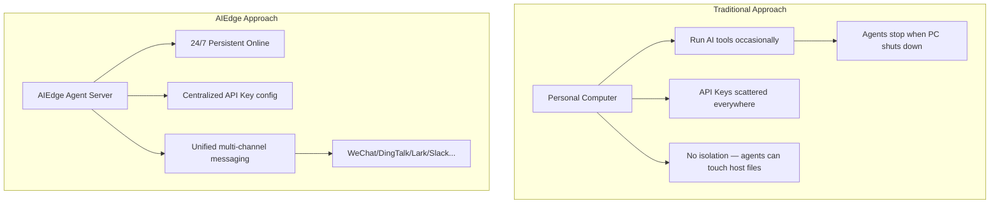

# Device Introduction

## What is the AIEdge Micro AI Agent Server?

The AIEdge Micro AI Agent Server is a **desktop-class AI agent dedicated hardware** device from HydroSpring Technology. It is built on the Allwinner H618 chip + Armbian Linux v25.05, with OpenClaw (multi-channel agent gateway) and Codex CLI (OpenAI terminal coding agent) pre-installed; Mihomo (Clash), Hermes Agent, and Claude Code are optional. By calling cloud LLM APIs, it provides enterprises and developers with a **24/7 online AI agent runtime platform**.

!!! note "Core Positioning"
    **AIEdge doesn't run models — it runs agents.** All AI inference is performed by cloud models via API calls. The device itself focuses on agent task orchestration, messaging channel access, and local persistence of skills and memory.

---

## Why Do You Need an AI Agent Server?

| Pain Point | AIEdge Solution |
|------|----------------|
| AI tools stop when computer shuts down | **24/7** independent operation, low power (5-10W) |
| Agents can freely read/write host files | **Isolated hardware**, agents run on a dedicated device |
| Team members manage API Keys individually | **Centralized config**, one Key shared across the team, cost-controlled |
| Multi-channel AI access is fragmented | One device, **20+ messaging platforms** |
| Agents can't "remember" context | Local persistent storage, **cross-session memory** |

---

## Core Capabilities at a Glance

| Capability | Description |
|------|------|
| :material-robot: **Multi-Agent Concurrency** | OpenClaw multi-agent routing — different agents for different departments/scenarios |
| :material-message-text: **20+ Messaging Channels** | WeChat, DingTalk, Lark, Slack, Telegram, Discord, and more |
| :material-cloud-outline: **Cloud Model Powered** | Supports Anthropic Claude / OpenAI GPT / OpenRouter / Qwen, etc. |
| :material-clock-outline: **Scheduled Automation** | Cron tasks, heartbeat monitoring, proactive push |
| :material-brain: **Persistent Memory** | Agent conversation memory stored locally, survives across days |
| :material-puzzle: **Skill Marketplace** | 13,000+ community skills, plug-and-play activation |

---

## Product Exterior

| Front Panel | Side Panel | Rear Panel |
|--------|--------|--------|
| Blue power LED ×1 | USB 2.0 ×2 | DC power jack ×1 |
| | TF card slot ×1 | HDMI ×1 |
| | | RJ45 Ethernet ×1 |
| | | AV port ×1 |
| | | USB 2.0 ×1 |

!!! note "Device Dimensions"
    Dimensions: 106mm × 106mm × 19mm | Weight: ~140g | Power: typical 5W, max 10W

---

## Target Users

- :material-account-tie: **IT Managers** — Deploy a unified AI agent entry point for your team
- :material-code-braces: **Software Developers** — Run tools like Claude Code persistently on the LAN
- :material-office-building: **Operations Teams** — Unified AI-powered responses across multiple customer messaging channels
- :material-school: **Education & Research** — Low-cost, low-power AI agent experimentation platform
- :material-laptop: **AI/Network Enthusiasts** — Personal 24/7 agent tinkering, low power, no noise

---

## Next Step

Continue reading **[Hardware Specifications](specs.md)** for detailed technical specs.
