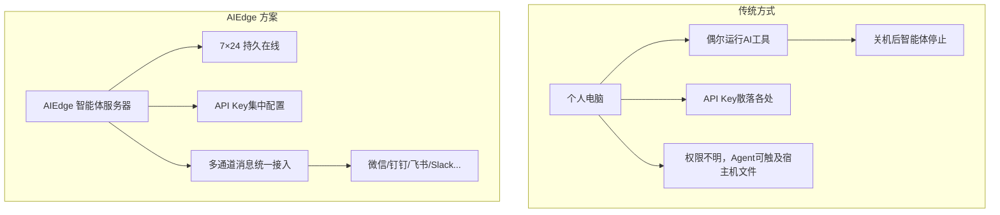

# 设备简介

## 什么是 AIEdge 微型AI智能体服务器？

AIEdge 微型AI智能体服务器是氢春科技打造的一款**桌面级 AI 智能体专用硬件**。它基于全志 H618 芯片 + Armbian Linux v25.05，出厂预装 OpenClaw（多通道智能体网关）和 Codex CLI（OpenAI 终端编码智能体），Mihomo (Clash)、Hermes Agent、Claude Code 可按需安装，通过调用云端大模型 API，为企业和开发者提供一个 **7×24 小时在线的 AI 智能体运行平台**。

!!! note "核心定位"
    **AIEdge 不跑模型，它跑智能体。** 所有 AI 推理通过 API 调用云端最强模型完成，设备本身专注于智能体任务的调度、消息通道的接入、以及技能与记忆的本地持久化。

---

## 为什么需要 AI 智能体服务器？

| 痛点 | AIEdge 解决方案 |
|------|----------------|
| AI 工具随电脑关机而停止 | **7×24 小时**独立运行，低功耗（5-10W） |
| 智能体可随意读写宿主机文件 | **独立硬件隔离**，Agent运行在专用设备上 |
| 团队成员各自管理 API Key | **集中配置**，一个 Key 全团队复用，成本可控 |
| 多渠道 AI 接入割裂 | 一个设备，接入 **20+ 消息平台** |
| 智能体无法"记住"上下文 | 本地持久化存储，**跨会话记忆** |

---

## 核心能力一览

| 能力 | 描述 |
|------|------|
| :material-robot: **多智能体并发** | OpenClaw 多代理路由，不同部门/场景使用不同智能体 |
| :material-message-text: **20+ 消息通道** | 微信、钉钉、飞书、Slack、Telegram、Discord 等全覆盖 |
| :material-cloud-outline: **云端模型驱动** | 支持 Anthropic Claude / OpenAI GPT / OpenRouter / 通义千问等 |
| :material-clock-outline: **定时自动化** | Cron 定时任务、心跳监控、主动推送 |
| :material-brain: **持久记忆** | 智能体对话记忆本地存储，跨天不丢失 |
| :material-puzzle: **技能市场** | 13000+ 社区技能，拖拽式启用 |

---

## 产品外观

| 前面板 | 侧面板 | 后面板 |
|--------|--------|--------|
| 蓝色电源指示灯 ×1 | USB 2.0 ×2 | DC 供电口 ×1 |
| | TF 卡槽 ×1 | HDMI ×1 |
| | | RJ45 网口 ×1 |
| | | AV 接口 ×1 |
| | | USB 2.0 ×1 |

!!! note "设备尺寸"
    尺寸：106mm × 106mm × 19mm｜重量：约 140g｜功耗：典型 5W，最大 10W

---

## 适用角色

- :material-account-tie: **企业IT管理者** — 为团队部署统一的 AI 智能体入口
- :material-code-braces: **软件开发者** — 将 Claude Code 等工具持久运行在局域网
- :material-office-building: **运营团队** — 多渠道客户消息统一接入 AI 智能回复
- :material-school: **教育与研究** — 低成本、低功耗的 AI 智能体实验平台
- :material-laptop: **AI/网络技术爱好者** — 个人 7×24 智能体折腾，低功耗不扰民

---

## 下一步

继续阅读 **[硬件参数](specs.md)**，了解详细的技术规格。
