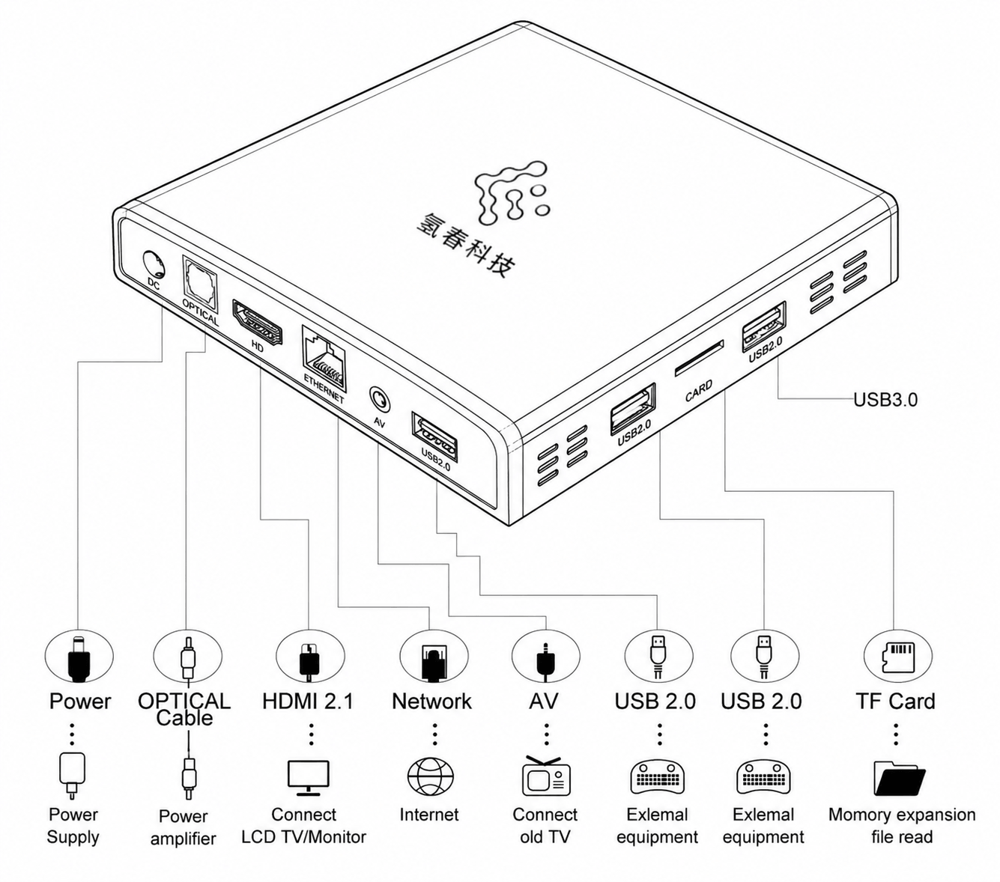

# Hardware Specifications

## Processor & Performance

| Parameter | Specification |
|:-------|:-----|
| Chipset | Allwinner H618, quad-core ARM Cortex-A53, up to 1.5GHz |
| GPU | ARM Mali-G31 MP2 |
| Architecture | ARM64 (aarch64) |

---

## Memory & Storage

| Parameter | Specification |
|:-------|:-----|
| RAM | **4GB** LPDDR4 |
| Onboard Storage | **128GB** eMMC 5.1 |
| External Expansion | USB 2.0 — USB flash drives, portable HDDs for storage expansion |
| Memory Card | MicroSD (TF) card slot, up to **512GB** |

---

## Network Connectivity

| Parameter | Specification |
|:-------|:-----|
| Wired | RJ45 ×1, 10/100Mbps auto-negotiation |
| Wi-Fi | Wi-Fi 5 (802.11ac), 2.4G / 5G dual-band |
| Bluetooth | Bluetooth 5.0 |

---

## Interface Panel

| Panel | Interface | Qty | Description |
|:---------|:-----|:----:|:-----|
| Front | Blue power LED | ×1 | System operating status indicator |
| Side | USB 2.0 Type-A | ×2 | USB drives, keyboard/mouse, 4G dongles, etc. |
| Side | MicroSD card slot | ×1 | TF card storage expansion |
| Rear | DC power jack | ×1 | 5V/3A input |
| Rear | HDMI 2.0a | ×1 | Up to 4K@60Hz display output |
| Rear | RJ45 Ethernet | ×1 | 10/100Mbps wired networking |
| Rear | AV port | ×1 | Composite audio/video output |
| Rear | USB 2.0 Type-A | ×1 | USB drives, keyboard/mouse, etc. |

### Interface Diagram

{: style="max-width:480px;"}

---

## Physical Specifications

| Parameter | Specification |
|:-------|:-----|
| Dimensions | 106mm × 106mm × 19mm |
| Weight | ~140g |
| Cooling | Fanless passive cooling (heatsink + grille), **completely silent** |
| Power Input | DC 5V / 3A (Type-C power, included with select models) |
| Typical Power | 5W (idle) / 10W (full load) |

---

## Environmental Requirements

| Parameter | Specification |
|:-------|:-----|
| Operating Temperature | 0°C ~ 50°C |
| Storage Temperature | -20°C ~ 65°C |
| Operating Humidity | 5% ~ 95% (non-condensing) |

---

## Software Stack

### Operating System

| Item | Details |
|:-----|:-----|
| OS | **Armbian Linux v25.05** (rolling, H618, CLI only) |
| Kernel | **Linux 6.12.11-edge-sunxi64** |
| Architecture | ARM64 (aarch64) |
| Pre-installed Components | Node.js 22+, Python 3.10, Git, Docker (optional) |

### AI Agent Frameworks

AIEdge ships with **OpenClaw** and **Codex CLI** pre-installed, **ready out of the box**. Mihomo (Clash), Hermes Agent, and Claude Code are optional and can be installed on demand.

| Software | Version | Role | Core Capabilities | Installation |
|:-----|:----:|:-----|:-----|:----:|
| **OpenClaw** | latest | Multi-channel AI agent gateway | Multi-platform messaging, multi-agent routing, skill marketplace, cron scheduling | **Pre-installed** |
| **Codex CLI** | latest | OpenAI terminal coding agent | Code generation/review/refactoring, terminal automation, Git workflow integration | **Pre-installed** |
| **Mihomo (Clash)** | latest | Network proxy service | Transparent proxy, subscription updates, rule-based routing to keep API connections smooth | Optional |
| **Hermes Agent** | latest | Native terminal autonomous AI agent | Persistent memory, self-evolving skills, 21+ platform messaging gateway, any-model support | Optional |
| **Claude Code** | latest | AI coding assistant CLI | Code generation/review/refactoring, project-level context understanding, Git workflow integration | Optional |

!!! info "How It Works"
    AIEdge **does not run LLMs locally**. All AI agent software calls cloud LLM services via API (Anthropic Claude, OpenAI GPT, DeepSeek, OpenRouter, etc.). The device itself serves as an agent runtime + API gateway + messaging hub, running persistently on your local network.

---

## Package Contents

| # | Item | Qty | Notes |
|:----:|:-----|:----:|:-----|
| 1 | AIEdge main unit | 1 | 4GB RAM / 128GB eMMC |
| 2 | Power adapter | 1 | DC or Type-C (included with select models) |
| 3 | Quick Start Guide | 1 | Available on request, under development |
| 4 | Warranty Card | 1 | Available on request, under development |

!!! note "Ethernet / HDMI Cables"
    Ethernet and HDMI cables are not included in the package. Contact customer service if you need to purchase them separately.

---

## LED Indicator

The device has a single blue power LED on the front panel:

| Status | Meaning |
|:-----|:-----|
| :material-power: **Solid Blue** | Device powered on, system running normally |
| :material-power: **Blinking Blue** | System booting (~30 seconds) |
| :material-power: **Off** | Device not powered |

---

## Next Step

Once you've confirmed the device specs, continue to **[Unboxing Checklist](unbox.md)**.
