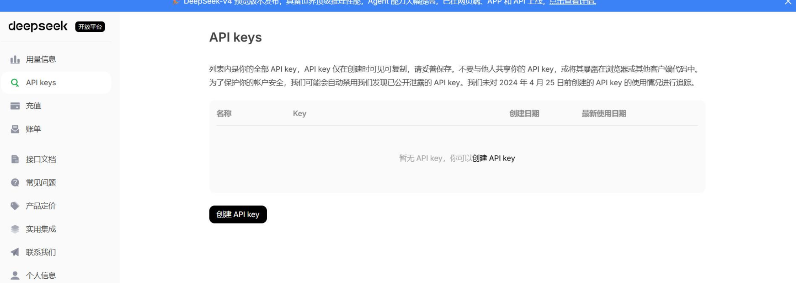
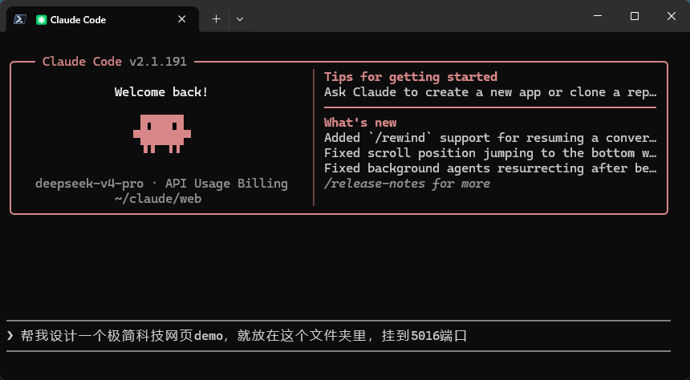
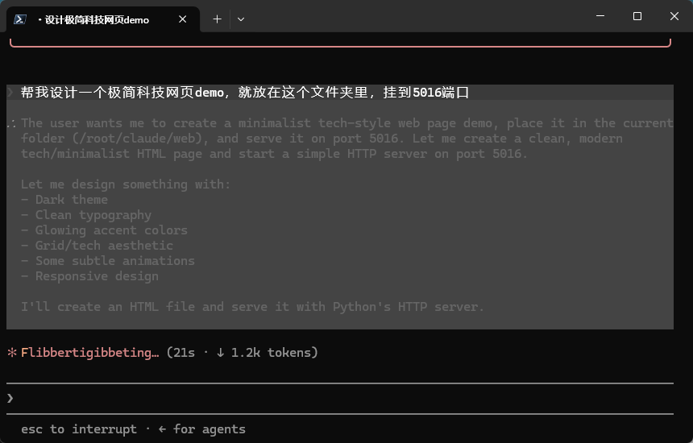
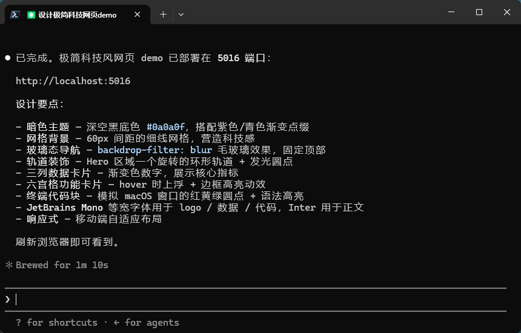
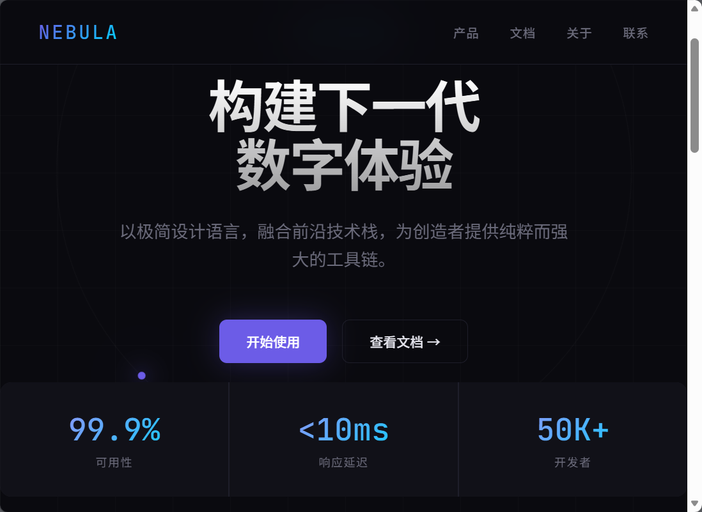
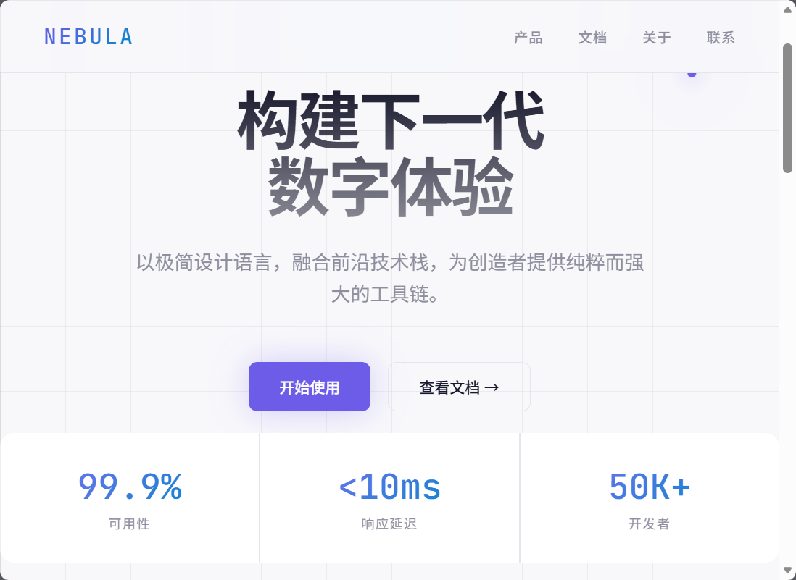

# 🌐 Claude Code + DeepSeek: Design & Deploy a Website

This tutorial demonstrates how to use **Claude Code** with the **DeepSeek API** on your AIEdge to design a website from scratch and deploy it on your LAN for team access.

---

## Step 1: Configure DeepSeek API Key (Permanent)

SSH into your AIEdge, then write the DeepSeek API configuration to `~/.bashrc` — configure once, persist forever.

### 1. Append Configuration

Replace the `sk-` key with your own DeepSeek API Key, then copy and run the entire block:

```bash
cat >> ~/.bashrc <<'EOF'
# Claude Code → DeepSeek API global configuration
export ANTHROPIC_BASE_URL="https://api.deepseek.com/anthropic"
export ANTHROPIC_AUTH_TOKEN="sk-YourDeepSeekAPIKeyHere"
export ANTHROPIC_MODEL="deepseek-v4-pro[1m]"
export ANTHROPIC_DEFAULT_OPUS_MODEL="deepseek-v4-pro[1m]"
export ANTHROPIC_DEFAULT_SONNET_MODEL="deepseek-v4-pro"
export ANTHROPIC_DEFAULT_HAIKU_MODEL="deepseek-v4-flash"
export CLAUDE_CODE_SUBAGENT_MODEL="deepseek-v4-flash"
EOF
```

### 2. Reload Config (Takes Effect Immediately)

```bash
source ~/.bashrc
```

### 3. Verify

```bash
# Check if the environment variable is loaded
echo $ANTHROPIC_BASE_URL

# Launch Claude to test
claude /status
```

{: style="max-width:600px;"}

!!! tip "Get Your DeepSeek API Key"
    Go to [platform.deepseek.com](https://platform.deepseek.com) to register and get an API Key. DeepSeek charges by usage with very low prices — a small top-up goes a long way.
    
    **SSH is the recommended approach**: write to `~/.bashrc` and it auto-loads on every SSH login — no need to reconfigure.

---

## Step 2: Create Project Directory

```bash
mkdir -p /root/projects/my-website
cd /root/projects/my-website
```

---

## Step 3: Generate a Website with Claude Code

Launch Claude Code on AIEdge and describe the website you want:

```bash
claude "Design a clean corporate homepage with the following:
- Top navigation bar (company name + About / Products / Contact)
- Hero section (headline + subtitle + CTA button)
- Three-column feature cards
- Footer with copyright
- Pure HTML + CSS, no frameworks
- Responsive design, mobile-friendly"
```

{: style="max-width:600px;"}

Claude Code receives the requirements and starts thinking & coding:

{: style="max-width:600px;"}

Task complete — Claude Code gives a completion report. Meanwhile, it has already automatically deployed the website to a local HTTP server — no manual steps needed.

{: style="max-width:600px;"}

---

## Step 4: LAN Preview & Iteration

From any device on the same LAN, open a browser and navigate to AIEdge's IP + port:

```
http://192.168.1.xxx:8080
```

Phones, tablets, colleagues' computers — all can view it. No cloud server, no domain registration needed.

{: style="max-width:600px;"}

Not happy with the result? Go back to SSH and continue the conversation to fine-tune. For example, change the background:

```bash
claude "Give it a cleaner background, go for a minimal look"
```

{: style="max-width:600px;"}

Iterate until you're satisfied.

---

## Step 5: Publish to the Internet (Optional)

LAN access only works within your local network. To make it **accessible from the internet**, we recommend **Cloudflare Tunnel** — free, no public IP required, auto-HTTPS.

We've written a complete setup guide on our WeChat official account:

[:material-open-in-new: Cloudflare Tunnel — Free Tunneling Guide](https://mp.weixin.qq.com/s/5zSdqS9lWovrzmBgeZOEyQ){ .md-button target="_blank"}

Once configured, external users can access your AIEdge-hosted website via your own domain. Our own demo is live at:

> 🔗 [https://demo.hybio.tech/](https://demo.hybio.tech/)

---

## Step 6: Auto-Start on Boot (Optional)

Make your website automatically start when the device boots:

```bash
# Create a systemd service
cat > /etc/systemd/system/my-website.service << EOF
[Unit]
Description=My Website
After=network.target

[Service]
Type=simple
WorkingDirectory=/root/projects/my-website
ExecStart=python3 -m http.server 8080 --bind 0.0.0.0
Restart=always

[Install]
WantedBy=multi-user.target
EOF

# Enable and start
systemctl enable my-website
systemctl start my-website
```

---

## Summary

| Step | Time |
|------|:----:|
| Configure API Key | 2 min |
| Generate website | 3 min |
| Fine-tune iterations | 5 min |
| LAN preview | Instant |
| Public publish (optional) | 10 min |
| **Total** | **~20 min** |

A palm-sized AIEdge, one API Key — 10 minutes to turn an idea into a website accessible to everyone on your LAN, another 10 minutes with Cloudflare Tunnel to share it with the world. That's the AIEdge daily driver.

---

## Next Step

Return to the **[Tutorials Home](index.md)** for more hands-on examples.
